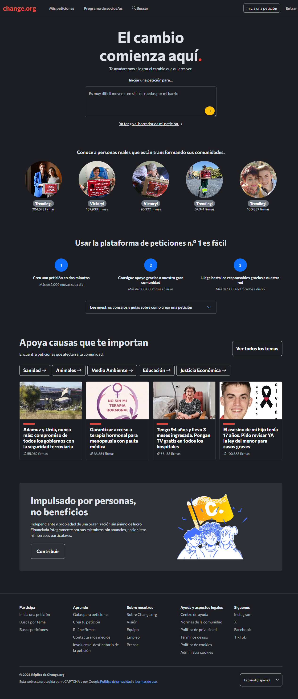
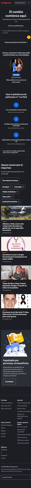
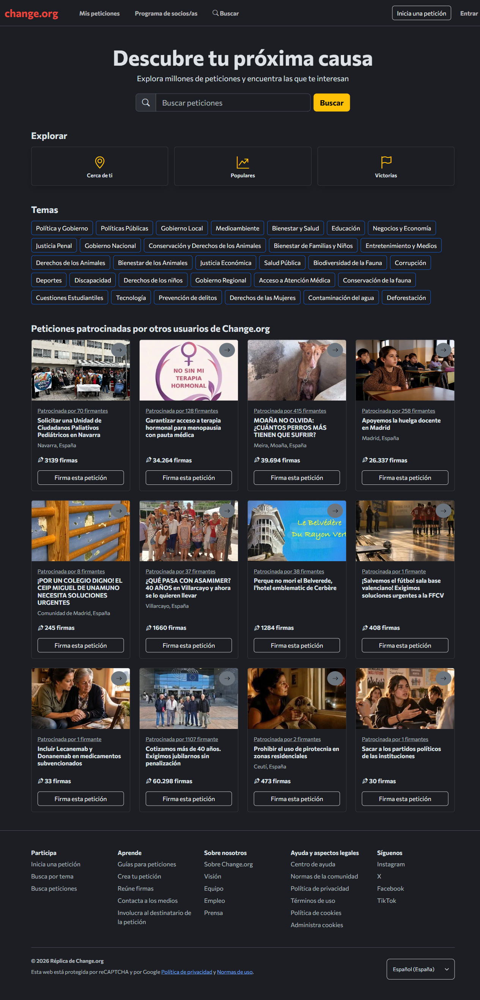
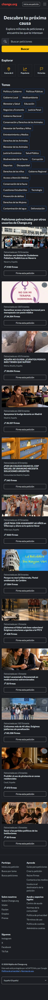
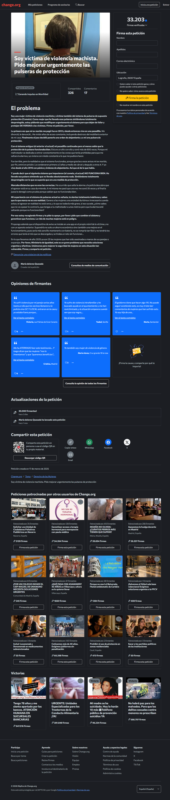
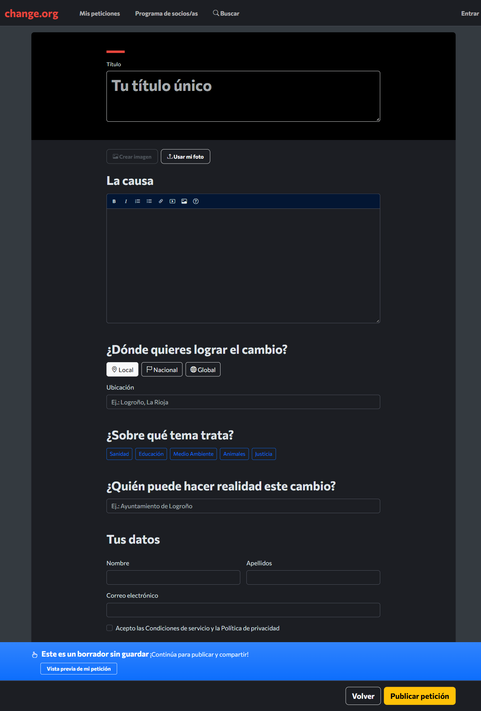
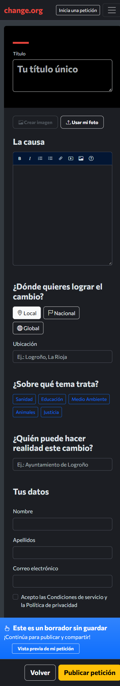

# Réplica de Change.org con Bootstrap 5

Réplica visual de cuatro páginas de [Change.org](https://www.change.org), maquetada con **HTML5, CSS3 y Bootstrap 5** siguiendo la metodología **Mobile First**.

Práctica de la asignatura **Diseño de Interfaces Web (DIW)** · 2º de Desarrollo de Aplicaciones Web (DAW).

URL: https://mk-1379.github.io/change-org-replica-bootstrap/

>  Proyecto con fines exclusivamente educativos. No está afiliado a Change.org. Los formularios son visuales: no se envía ni se guarda ningún dato.

## Páginas

| Página | Archivo | Contenido |
|---|---|---|
| Inicio (landing) | [`index.html`](index.html) | Hero con buscador de ideas, historias destacadas (carrusel en móvil), pasos, guías, causas y bloque de misión |
| Listado de peticiones | [`pages/peticiones.html`](pages/peticiones.html) | Buscador, accesos rápidos, temas y tarjetas de peticiones patrocinadas |
| Detalle y firma | [`pages/peticion.html`](pages/peticion.html) | Petición completa, formulario de firma fijo al hacer scroll, opiniones, actualizaciones y compartir |
| Crear petición | [`pages/crear.html`](pages/crear.html) | Formulario completo en **una sola página**: título, imagen, causa, ámbito, tema, destinatario y datos personales |

Todas las páginas están enlazadas entre sí desde la barra de navegación y el pie de página.

## Tecnologías

- **HTML5** semántico
- **CSS3**: solo para lo que Bootstrap no trae (colores de la marca, tamaños de imágenes y pequeñas animaciones)
- **[Bootstrap 5.3](https://getbootstrap.com/)** (desde CDN)
- **[Bootstrap Icons](https://icons.getbootstrap.com/)** (desde CDN)
- **JavaScript**: validación de formularios basada en el ejemplo de la documentación de Bootstrap
- Tipografía **Commissioner** (Google Fonts), la misma que usa Change.org

### Componentes y utilidades de Bootstrap utilizados

- **Rejilla:** `container`, `row`, `col-*`, `row-cols-*` y gutters (`g-*`)
- **Componentes:** Navbar, Carousel, Card, Accordion, Collapse, List group, Badge, Progress, Button group / toolbar y Forms (validación, *toggle buttons*, input group)
- **Utilidades:** flexbox, espaciado, colores, posición, `sticky-lg-top`, `sticky-bottom` y modo oscuro con `data-bs-theme="dark"`

## Responsive (Mobile First)

El diseño parte de la versión móvil y se adapta con los breakpoints de Bootstrap:

| Tamaño | Breakpoint | Cambios principales |
|---|---|---|
| Móvil | < 768 px | Contenido en una columna, menú hamburguesa, historias en carrusel y formulario de firma debajo del contenido |
| Tablet | ≥ 768 px (`md`) | Tarjetas y pasos en varias columnas |
| Escritorio | ≥ 992 px (`lg`) | Menú completo, formulario de firma fijo en la columna derecha y más tarjetas por fila |

## Estructura del proyecto

```
EjercicioChangeorg/
├── index.html          # Página de inicio
├── pages/
│   ├── peticiones.html # Listado de peticiones
│   ├── peticion.html   # Detalle y firma
│   └── crear.html      # Crear una petición
├── css/
│   └── styles.css      # Estilos propios
├── js/
│   └── main.js         # Validación de formularios
├── img/                # Imágenes (WebP) y favicon
└── screenshots/        # Capturas en móvil, tablet y escritorio
```

## Cómo verlo

No necesita instalación ni servidor:

1. Descarga o clona el repositorio.
2. Abre `index.html` en el navegador.

También puedes usar la extensión **Live Server** de VS Code para que la página se recargue al guardar cambios.

> Hace falta conexión a internet para cargar Bootstrap, los iconos y la fuente desde sus CDN. Las imágenes están incluidas en `img/`.

## Capturas

Haz clic en cualquier captura para verla a tamaño completo. En la carpeta [`screenshots/`](screenshots/) también están las versiones de tablet.

### Inicio

<p>
  
  
</p>

### Listado de peticiones

<p>
  
  
</p>

### Detalle y firma

<p>
  
  
</p>

### Crear petición

<p>
  
  
</p>

## Autor

**Mario Díaz González** · [GitHub](https://github.com/MK-1379) · [Portfolio](https://mk-1379.github.io)

2º DAW · Sagrado Corazón Jesuitas (Logroño)
